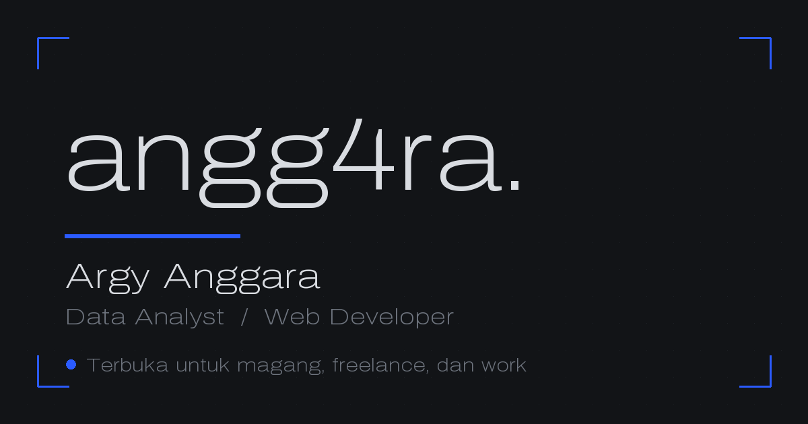

<h1 align="center">angg4ra.</h1>

<p align="center">
  <b>Portofolio Argy Anggara</b><br>
  Data analyst yang membersihkan data, mencari jawabannya, lalu membangun aplikasi yang menampilkannya.
</p>

<p align="center">
  <a href="https://angg4ra.my.id"></a>
  
  
  
  
</p>

<p align="center">
  <a href="https://angg4ra.my.id"></a>
</p>

---

## Isi

Satu halaman, satu file. Tidak ada framework UI, tidak ada bundel JavaScript, tidak ada CMS.
Semua HTML dirender saat build, semua interaksi ditulis tangan dalam satu `<script>` inline.

Total unduhan halaman depan: **~91 KB HTML + 84 KB gambar repo + 101 KB PDF CV**. Build statis penuh, tidak ada server.

## Mekanik

Bukan animasi tempelan. Semua dihitung ulang per frame dan berhenti kalau tab tidak aktif.

| Mekanik | Detail |
|---|---|
| Dot field | canvas 650 / 1050 / 1500 titik mengikuti lebar layar, `dpr` dipotong di 1.5 supaya laptop 4K tidak membakar fill-rate |
| Shockwave | klik memicu ring yang mendorong titik keluar, pengaruhnya habis dalam 46px |
| Ink trail | jejak biru di belakang kursor, pudar 700ms, hanya di `pointer: fine` |
| Scroll weight | scroll cepat meregangkan field secara vertikal, spring balik, clamp ±4000 |
| Theme wipe | 90 ray polygon bergerigi, bukan `circle()`. Turun ke 48 ray di layar sempit, dilewati total kalau `hardwareConcurrency <= 4` |
| Decode glyph | teks i18n resolve huruf per huruf lewat `#/<>_{}[]\|%$&*+=~^` |
| Boot log | counter naik 1500ms lalu menggulir jadi angka asli. Paragraf LCP sengaja dibuka lebih awal supaya tidak ikut tertahan 2100ms |
| Pipeline stepper | ingest, clean, model, ship. Fixed kanan bawah, ikut posisi scroll |
| Waffle | 100 sel, 85 biru, disinkronkan ke `aria-expanded` lewat `MutationObserver` |
| Magnet dan tilt | pill, tombol salin, dan kartu repo menarik ke arah kursor. Hanya `pointer: fine` |

Semua di atas mati kalau `prefers-reduced-motion: reduce`. Loop berhenti sendiri saat tab tidak aktif atau tidak ada gerakan selama 6 detik.

## Bagian halaman

`#work` karya pilihan · `#results` yang tidak berhasil · `#lab` eksperimen kecil · `#about` · `#stack` · `#contact`

Filter proyek (Semua, AI dan ML, Data, Web, Mengajar), overlay studi kasus yang bisa ditutup dengan `Esc`, dan toggle bahasa ID/EN yang menyimpan pilihan di `localStorage`.

## Data GitHub ikut build

Section **Langsung dari repo** mengambil profil dan repo publik dari [`4RGY`](https://github.com/4RGY), lalu di-commit sebagai manifest. Build statis tidak pernah menembak jaringan.

```bash
npm run gh:sync     # tarik ulang profil, repo, bahasa -> src/data/github.json
```

Tangkapan layar repo diambil dari kartu social preview resmi GitHub, dikonversi ke WebP. Enam gambar, total 84 KB, tanpa browser headless.

## Jalankan

```bash
npm install
npm run dev         # http://localhost:4321
```

```bash
npm run build       # -> dist/
npm run preview     # cek hasil build
```

Butuh Node >= 22.12.

## Test

```bash
npm test            # build dulu, baru uji artefak di dist/
```

13 assertion, semuanya membaca `dist/`, bukan sumber yang belum di-generate. Yang dijaga:

- tidak ada em-dash atau en-dash di HTML ter-deploy
- tidak ada `href="#"` mati
- PDF CV ada, ikut ter-deploy, dan metadata Canva-nya sudah bersih
- SEO lengkap: title, canonical, OG, Twitter card, JSON-LD `Person`
- `h1` memuat nama dan peran
- halaman 404 ada dan `noindex`
- security header lengkap di `_headers`
- `robots.txt` dan sitemap valid
- favicon custom, multi-ukuran
- kartu repo cocok dengan manifest, file `public/shots/*.webp` ada, tidak ada placeholder email yang bocor

## Struktur

```text
src/
├── pages/
│   ├── index.astro      # seluruh situs: CSS, HTML, satu script inline
│   └── 404.astro
└── data/
    └── github.json      # manifest repo, hasil npm run gh:sync

scripts/
├── fetch-github.mjs     # tarik profil + repo + bahasa dari GitHub
├── clean-cv-metadata.py # buang metadata Canva dari PDF
└── gen-seo-assets.py    # og-image dan favicon

public/
├── shots/*.webp         # 6 social preview repo
├── cv-anggara.pdf
├── _headers             # CSP-adjacent: XFO, nosniff, HSTS, Permissions-Policy
└── robots.txt

tests/portfolio.test.mjs # 13 assertion terhadap dist/
```

## Token desain

Rasio 60/30/10, dark-first, satu warna aksen.

```
--base #121417   latar, 60%
--alt  #d9dce1   teks, 30%
--blue #2b5bff   aksen, 10%
```

Kontras `--alt` di atas `--base` = 13.4:1. Biru hanya dipakai untuk bentuk, garis, dan titik, tidak pernah untuk teks kecil. Font Archivo variable, `wdth 62..125`, `wght 100..900`.

Tema terang bukan inversi: `--base` dan `--alt` bertukar, `color-scheme` ikut berganti. Anti-FOUC dikerjakan di `<head>` sebelum paint pertama.

## Deploy

Cloudflare Pages, tersambung ke `main`. `git push` memicu build dan rilis dalam 30 detik sampai 2 menit.

```bash
git push origin main
```

Verifikasi rilis bukan dari HTTP 200. Cara yang benar: judul halaman di `https://angg4ra.my.id` harus berubah, lalu buka dengan `browser_console` dan pastikan nol `js_errors`.

## Lisensi

Proyek personal. Silakan dijadikan referensi, tapi jangan dijiplak utuh lalu diaku karya sendiri.

---

<p align="center">
  <a href="https://angg4ra.my.id">angg4ra.my.id</a> ·
  <a href="https://github.com/4RGY">GitHub</a> ·
  <a href="https://www.linkedin.com/in/argy-anggara/">LinkedIn</a> ·
  <a href="mailto:rgyanggara@gmail.com">rgyanggara@gmail.com</a>
</p>
